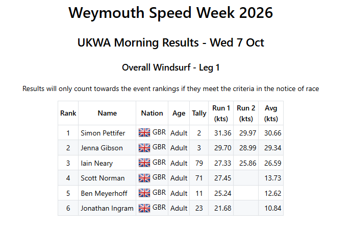

## UKWA Discussion

Who: Michael George + Jenna Gibson

When: 12 Oct 2026

### Summary

The content of this document is after trying to make sense of notes that were scribbled down during the conversation.

They are not minutes, not in the precise order that points were discussed.

It is simply aiming to capture some of the ideas, so they can be revisited when time allows.

### Recent Events

#### Review of 2024

Would have been fine if the 2023 proposal of 25% at 27 kt or 50% at 25 kt had been accepted.

Unfortunately we were stuck with 25% at 28 kt or 50% at 26 kt, so the 2024 event had no valid UKWA heats.

#### Review of 2025

A very light year except for the final day, and Jenna suggested even that day was a bit too light.

Fri [afternoon](https://results.weymouthspeedweek.com/events/2025/20251017/leg-2.html) would have been deemed valid using a criteria of 50% of finishers having at least two runs of 24 kt.

#### Review of 2026

- Wed 7 Oct - Fin [results](https://results.weymouthspeedweek.com/events/2026/20261007/index.html) from the afternoon were worthy of recogniition, but deemed invalid
  - Perhaps worth noting that 25% at 26 kt, or 50% at 24 kt would have been valid

- Thu 8 Oct - Fin [results](https://results.weymouthspeedweek.com/events/2026/20261008/index.html) NOT worthy of UKWA rankings. Good for foiling, but only 3 in the morning
  - Clearly a foil day, but no counting results. It would have been good to have more than 3 people

- Fri 9 Oct - Fin [results](https://results.weymouthspeedweek.com/events/2026/20261009/index.html) from the morning, and afternoon worthy of UKWA rankings
  - Windy day and no issue the validity of heats using past, present, or future rules

### Topics Discussed

- Intentions
  - Chance for everyone to get 2 decent runs on medium sized slalom kit
  - No requirement for lightweights to be using an 85 cm board + 8.5 m
  - ... or formula boards winning the UKWA titles because of their kit
- Can it be based on windspeed?
  - Tricky... how to we measure it given what we know about readings from the harbour wall
  - Didn't see an easy way to do it, without it being too complicated / onerous
- Different speed requirements for beach and harbour courses?
  - Perhaps based on a few top riders... top 2, 3, or 4?
  - e.g. Harbour course requirement = 27 or 28 kt and beach course requirement = 30 kt
- Perhaps the speed requirements should be based on 10% of the registrations?
  - We discussed 10% of 40 riders, but afterwards I considered the number of "all week" entries
  - e.g. 30 UKWA adults entered for the week in 2026, so 3 people requiring specific speeds
  - Perhaps it can be the sole basis for validity... no second criteria
- Considered assessing the validity of the heat from the UKWA pro fleet riders
  - e.g. 50% of the Pro fleet need to achieve a specific speed at least twice
  - Automatically excludes youths and slower women
  - ... but 1 or 2 individuals could potentially sabotage the heat, so decided against it
- Discussed separate heats for fin and foil
  - e.g. Looks like foil weather, so lets have a foil heat, or vice-versa
  - Perhaps some upper wind limit for the foil?
- Heat times
  - Considered 30 or 60 min notifications of the heat starting
  - Harbour course can be harder to get to, so perhaps allow more time to get to the course?
  - Beach course can be easier to get to, so can perhaps get away with 30 minutes notice?

### 10% of Fleet

Instead of looking at how many people sailed in the heat, perhaps set requirements based on the number of UKWA registrations.

This can be determined beforehand, and the speed requirement could simply be "X riders doing Y knots at least 2 times".

Some stats for UKWA fin entrants in recent years:

| UKWA - windsurf (fin)          | 2023 | 2024 | 2025 | 2026 |
| ------------------------------ | :--: | :--: | :--: | :--: |
| Adults and youths              |  39  |  48  |  34  |  39  |
| Adults - all week, or weekdays |  33  |  43  |  32  |  37  |
| Adults - all week              |  28  |  37  |  31  |  30  |
| Pro fleet                      |  6   |  11  |  9   |  12  |

These stats were produced after the meeting, and around 30 "all week" UKWA fin entrants is fairly typical.

Contemplating using a simple rule of "3 riders doing X knots at least 2 times" for a given craft... fin, foil, and wing.

e.g. In 2026, 3 riders equates to 10% of the UKWA fin entries (all week), and 25% of the UKWA Pro fleet.

### Minimum Participants

The [morning](https://results.weymouthspeedweek.com/events/2026/20261007/leg-1.html) of Wed 7 Oct 2026 was an anomaly because the course opened very late, and riders had trouble getting to it.

Had everyone been competing, it would probably have been a counting round, but the limited number of people was an issue.

Discussed minimum numbers doing 2 runs for a valid round, perhaps calculated from 25% of the "all week" UKWA adults (fin).

In 2026 this would equate to a minimum of 8 people needing at least 2 runs, because there were 30 "all week" UKWA adults (fin).

### Fin or Foil

Discussed whether it makes sense to dedicate some UKWA sessions solely to the fin, and some to the foil.

Foil rounds can potentially be a bit shorter since as it is often easier to do the runs and get back to the start.

Maximum of 2 heats per craft, per day. Need to be mindful that longer sessions may help to ensure validity.

It may also make sense to run the fin and foil concurrently on some days, depending on the conditions.

### Concerns

A number of factors may cause a decent day not to be deemed valid if the rules are not quite right.

- Some people don't come on the less windy days, opting to work instead.
  - This should not result in decent conditions being deemed invalid, just because 1 or 2 fast riders are absent.
- Some people work on the non-winning days of Weymouth Speed Week.
  - These days could still be good for UKWA competition though, and every opportunity should be taken.
- Some people sit on small kit, and wait for the magic gust in the hopes of winning a pot or WSW.
  - If a fast rider chooses this tactic then it should not cause the UKWA heat to be deemed invalid.

### Next Steps

Investigate the efficacy of the following rules:

- Windfoil
  - At least **3 of the finishers** must achieve the required speed of **24 knots** at least **2 times **
  - n.b. This target is pretty easy for the likes of Scotty, Jenna, Mike, Garry, and Scott
- Wingfoil
  - At least **3 of the finishers** must achieve the required speed of **22 knots** at least **2 times**
  - e.g. Thu [8 Oct 2026](https://results.weymouthspeedweek.com/events/2026/20261008/leg-2.html) PM - There were only 3 riders, but they all went over 24 kt at least twice
- Windsurf
  - Harbour - At least **3 of the finishers** must achieve the required speed of **27 knots** at least **2 times**
    - e.g. Wed [7 Oct 2026](https://results.weymouthspeedweek.com/events/2026/20261007/leg-2.html) PM - 6 riders went over 27 kt at least twice
  - Beach - At least **3 of the finishers** must achieve the required speed of **30 knots** at least **2 times**
    - This is usually not an issue for the faster riders in the fleet
  - ... and at least **X riders** must complete at least **2 runs**
    - Calculated in advance - e.g. 25% of 32 UKWA fin entries (all week) would be **8 riders**

Recent years may be difficult to review because of people using fins and foils.

### Caveats

A single criteria is always going to work for some days, and not for others.

The essence is "**3 of the finishers** must achieve the required speed of **X knots** at least **2 times**".

There is no perfect value that can be chosen the X, but care must be taken in its choice.

### References

Just a few dates that were discussed:

- Thu [12 Oct 2023](https://results.weymouthspeedweek.com/events/2023/20231012/ukwa.html) PM was deep water shore course - Simon did 33.40 kt (33.6 on GPS) on 8.4 + 85 cm
  - This was a valid round under the old rules - 25% of the fleet doing at least 2 runs over 28 kt
- Fri [17 Oct 2025](https://results.weymouthspeedweek.com/events/2025/20251017/leg-2.html) PM was a harbour course where Jenna went similar speed on fin and foil
  - This was not a counting round, but it was the best fin session of the week
- Wed [7 Oct 2026](https://results.weymouthspeedweek.com/events/2026/20261007/leg-2.html) PM was a harbour course - 6 riders went over 27 kt at least twice
  - Did not count because we were one rider short of the 25% criteria
